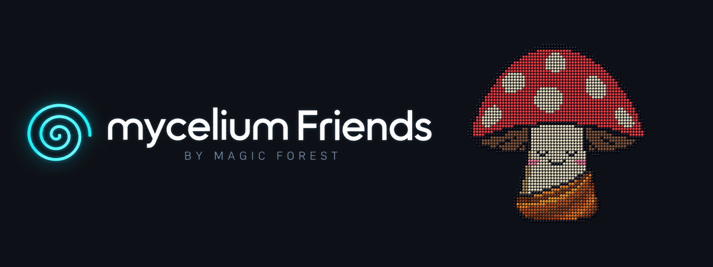
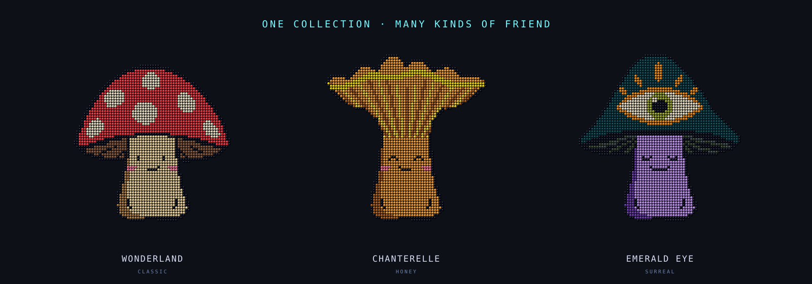
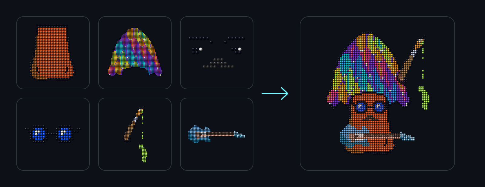
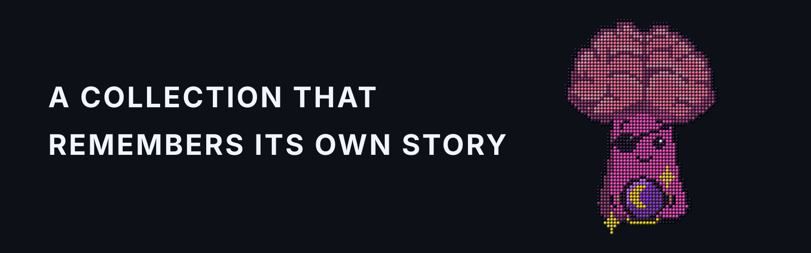
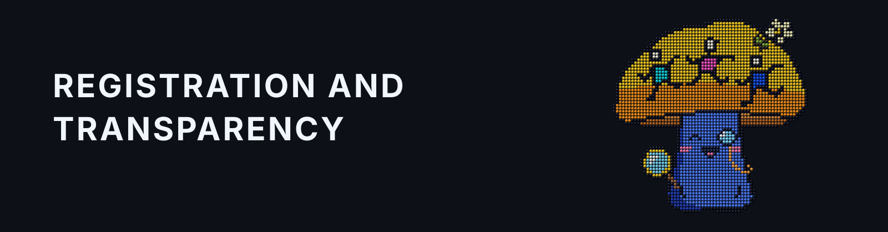
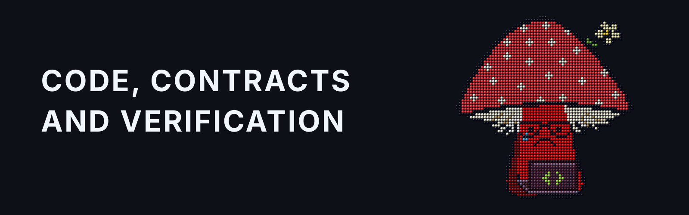
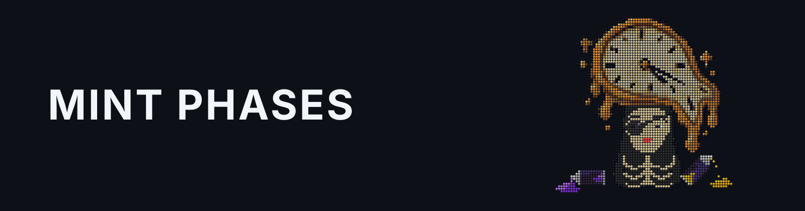
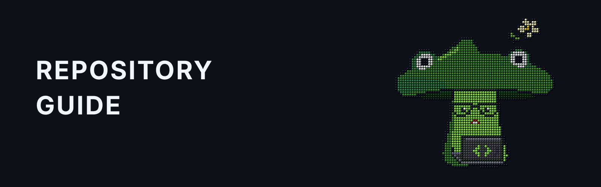
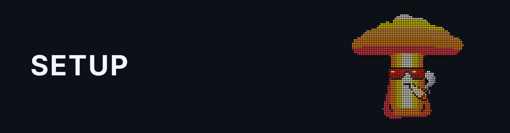
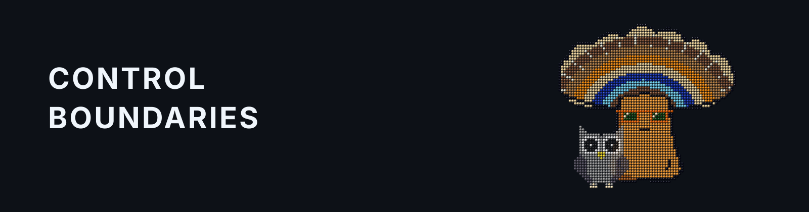

# **🌀** mycelium Friends



**A fully on-chain ERC-721 collection by Magic Forest. It stores its original
SVG artwork, metadata, trait labels and descriptions entirely on Ethereum.
Collectors choose a six-part genotype. Every genotype can be minted only once.**

The collection was created to support
[Magic Forest](https://magicforest.land/): a registered Spanish non-profit
building a much larger ecosystem around one clear goal — acquire land in Spain,
plant a native forest and create an Art Hub where art, education, science,
sport and community can meet. All net collection proceeds go to Magic Forest
Association.

[Build a Friend](https://mycelium.magicforest.land/#traits) ·
[Walk the Spiral](https://mycelium.magicforest.land/#spiral) ·
[Verify the contract](https://etherscan.io/address/0x49f3A83a8EE0B1BB4334c5Fa997565926234648F#code) ·
[Read the documentation](docs/README.md)

## Official links and safety

- **Collection:** [mycelium.magicforest.land](https://mycelium.magicforest.land/)
- **Magic Forest:** [magicforest.land](https://magicforest.land/)
- **Contract:** [`0x49f3A83a8EE0B1BB4334c5Fa997565926234648F`](https://etherscan.io/address/0x49f3A83a8EE0B1BB4334c5Fa997565926234648F#code)
  · [Sourcify](https://sourcify.dev/server/v2/contract/1/0x49f3A83a8EE0B1BB4334c5Fa997565926234648F)
- **Official source:** [github.com/MagicForestLand/mycelium](https://github.com/MagicForestLand/mycelium)

Only mint through the official collection site and confirm the contract address
in your wallet before signing. The Magic Forest team will never contact you
first by direct message and will never ask for your seed phrase, recovery
phrase, private key or a transfer to “verify” your wallet.

## Meet your Friend

It begins with play. Choose a stem, a cap, a temperament, a pair of glasses, an
accessory and something your mushroom likes doing. Six small choices become one
particular myFriend — a character that begins to feel like yours before it ever
reaches your wallet.

Choose deliberately in the [Builder](https://mycelium.magicforest.land/#traits),
or roll the dice and meet whoever appears. Every preview is assembled from the
same reviewed art model used by the contracts. Minting records that exact
six-part genotype on Ethereum and gives the Friend a place in the shared
[Spiral](https://mycelium.magicforest.land/#spiral).



## Six parts. 2<sup>28</sup> possible Friends.

There are **244 selectable trait variants** across six families. Pick one from
each family and the choices multiply into **268,435,456 possible genotypes**.
The cap sets the silhouette; the stem gives it a body; temperament supplies the
face. Glasses change the point of view, an accessory adds a small companion or
flourish, and a hobby gives the Friend something to care about.



The arithmetic is part engineering, part number poetry:

```text
32 × 128 × 32 × 16 × 4 × 32
= 2⁵ × 2⁷ × 2⁵ × 2⁴ × 2² × 2⁵
= 2²⁸
= 16⁷
= 268,435,456
```

The exponents add up to **28**. Twenty-eight is the seventh triangular number
(`1 + 2 + 3 + 4 + 5 + 6 + 7`), the fourth hexagonal number and the second
perfect number (`1 + 2 + 4 + 7 + 14 = 28`). Its power-of-two structure remains
unusually visible in other numeral systems: `2²⁸` is a one followed by 28
zeroes in binary, `0o2000000000` in octal and, because it is also `16⁷`,
`0x10000000` in hexadecimal.

That enormous number is the space of possible Friends, not a forecast or promise
of how many tokens will exist. The commercial sale cap is a separate, immutable
contract value. A genotype may be minted only once; after that, its exact
six-part combination belongs to its first and only token. Explore every
canonical choice in the
[catalog](collection/catalog/catalog.json), or read how the six layers become
one on-chain SVG in the [artwork architecture](docs/contracts/core/architecture/ARTWORK.md).

## A collection that remembers its own story



Every myFriend joins the [Spiral](https://mycelium.magicforest.land/#spiral) in
minting order. The Spiral is not a leaderboard and its Archimedean geometry does
not set the price. It is a shared history: the first Friend, the next Friend,
and every strange little personality that follows.

The original artwork, traits, descriptions and compositor logic live on
Ethereum. [`originalSVG`](docs/contracts/core/architecture/ARTWORK.md) always
returns a Friend's birth artwork, while
[`tokenURI`](docs/contracts/core/architecture/ARCHITECTURE.md) returns its
on-chain metadata and image. The website makes this pleasant to explore, but it
is not where a myFriend's identity is kept.

Token IDs remain simple chronological numbers. The immutable birth genotype is
stored separately, so whether a Friend is number 1, 100 or 10,000 in the shared
story, it remains the only token with its exact six-part identity.

## First the mushrooms. Then the forest.

There is a real-world purpose behind these little on-chain friends. Magic Forest
is working to buy land in Spain, plant a native forest and create an Art Hub for
a community. mycelium Friends turns a digital collection into one part of that
shared dream — openly, traceably and without pretending the road there is easy.

### Meet the people behind the project

The short film below is the human version of the story: who started Magic
Forest, why we began, and what we hope to grow.

<a href="https://www.youtube.com/watch?v=_owe-Pgs2Ek"></a>

**Hannah & Dima — Founders of Magic Forest.**
[Watch the film on YouTube →](https://www.youtube.com/watch?v=_owe-Pgs2Ek)

## Registration and transparency



You do not have to take the mission on trust. Magic Forest is registered with
the Government of Catalonia as **Asociación Magic Forest**, registration number
`77434`, since 16 April 2025. The Generalitat's redesigned registry no longer
provides a stable public link to an individual record: use its official
[Guide to registered entities](https://justicia.gencat.cat/ca/serveis/guia_d_entitats/)
or [open-data register](https://analisi.transparenciacatalunya.cat/Legislaci-just-cia/Entitats-jur-diques-del-Registre-d-entitats-de-Cat/y6fz-g3ff)
and search for `Asociación Magic Forest` or `77434`.

The association's
[founding act](https://magicforest.land/assets/pdf/founding-act-2025-01-20.pdf),
[registration certificate](https://magicforest.land/assets/pdf/registration-certificate-2025-04-25.pdf),
[registration resolution](https://magicforest.land/assets/pdf/registration-resolution-2025-04-16.pdf),
[tax ID certificate](https://magicforest.land/assets/pdf/tax-id-certificate-2025-04-24.pdf)
and [constitution](https://magicforest.land/assets/pdf/association-constitution-2025-04-17.pdf)
are direct public documents. Bank statements, payment records, live finances and
crypto activity are published in the human-facing
[Transparency section](https://magicforest.land/transparency). The project is
equally open about what comes next: the land has not been purchased yet, and the
forest and Art Hub still have to be built.

**Magic Forest Friends LLC**, a Wyoming company (state file `2026-002117174`),
is the designated operator for primary sales of mycelium Friends. All net
collection proceeds are designated for
[Magic Forest Association](https://magicforest.land/), the registered Spanish
non-profit behind the project, to help plant the forest. The project explains
the calculation and publishes its records in the
[Transparency section](https://magicforest.land/transparency).

Buying a myFriend is an artwork purchase, not a donation or a promise of holder
utility. If you would rather support the non-profit directly, you can
[donate to Magic Forest Association](https://magicforest.land/donate).

## Code, contracts and verification



The artwork may be playful; the machinery behind it is meant to be serious and
inspectable. The NFT core is non-upgradeable. Its
[verified mainnet contract](https://etherscan.io/address/0x49f3A83a8EE0B1BB4334c5Fa997565926234648F#code)
matches the [published source on Sourcify](https://sourcify.dev/server/v2/contract/1/0x49f3A83a8EE0B1BB4334c5Fa997565926234648F),
and the durable [deployment record](deployments/core/ethereum/mainnet.json) binds
the address, source commit, release digest, catalog and finalized blocks
together. A frontend release can make the experience better, but it cannot
rewrite the contract or the original art.

### Verified mainnet release

| Item | Verified value |
| --- | --- |
| Network | Ethereum mainnet (`chainId 1`) |
| Collection | [`0x49f3…648F`](https://etherscan.io/address/0x49f3A83a8EE0B1BB4334c5Fa997565926234648F#code) |
| Name / symbol | `Mycelium Friends` / `MYFRIENDS` |
| Deployment block | `26259980` |
| Immutable source | tag `mycelium-friends-core-v1.0.0`, commit `5b7d890039dc0c660fabaa8b03c5f0b5a8654e86` |
| Release digest | `bf164a80af6f614241126ad0959777f013c494c3327064db353e5647dde5eb1e` |
| Initial owner / immutable treasury / initial royalty receiver | Safe [`0x6194…3f8`](https://etherscan.io/address/0x61942881D7ED31aE8935De4d454820d4214443f8) |
| Initial state | `PAUSED`, supply `0` |

The deployment began `PAUSED`. Publishing the repository or website cannot open
minting: starting each sale phase requires a separate, reviewed Safe action.
These are deployment facts, not a live sale-status feed. Read the current phase
and roles from the contract; the treasury address is immutable. The Safe's
owner list and signature threshold are mutable operational security settings.
They can change without changing the Safe address; verify their current values
on-chain.

Behind the friendly interface, the NFT core provides:

- buyer-selected genotypes with collection-wide uniqueness enforcement;
- a permanently free, lifetime-quota allowlist phase;
- buyer-bound public commit/reveal protection;
- linear public pricing and atomic batch minting of 1–32 NFTs;
- ERC-2981 royalties capped permanently at 5%;
- ERC-4906 metadata update signaling;
- an optional bounded phenotype/image source without replacing birth identity;
- no burn path and no upgradeable NFT core.

The repository includes deterministic tests and internal reviews. We do not
present either as an independent security audit; the current trust model and
reporting route live in the [Security Policy](SECURITY.md).

## Mint phases



The allowlist phase is free apart from Ethereum gas and uses lifetime wallet
quotas. The later public phase follows a linear price curve. Public purchases use
a buyer-bound commit/reveal flow with a minimum 60-second protection interval,
so a normal purchase takes two transactions. Before the commitment prompt, the
site saves recovery state. After the protection interval, you review the price
cap before the purchase transaction. The wallet network and configured contract
are checked before signing. The full sequence is documented in the
[mint lifecycle](docs/contracts/core/architecture/MINTING.md).

## What “fully on-chain” means here

SVG is an image format drawn from instructions rather than fetched as a hosted
picture. For mycelium Friends, those instructions and the words that describe
them are part of the Ethereum deployment itself:

- original SVG layers, compositor logic, metadata, trait names and descriptions
  are stored in the immutable Ethereum deployment;
- `originalSVG(tokenId)` always returns the birth artwork for a minted Friend;
- `tokenURI(tokenId)` returns on-chain JSON and an on-chain SVG image;
- an optional bounded phenotype source may change the displayed composition, but
  cannot replace or erase the immutable birth genotype or original SVG;
- the website, RPC and snapshot API are conveniences for discovery and minting,
  not custodians of NFT identity.

```mermaid
flowchart LR
  B[Builder\nsix traits] --> G[Unique genotype]
  G --> M[Allowlist mint\nor public commit/reveal]
  M --> C[MyceliumFriends\nERC-721]
  C --> D[Descriptor + art banks]
  D --> U[tokenURI + originalSVG]
  C --> S[Chronological Spiral]
  SAFE[Safe owner] -. phase, quota and royalty administration .-> C
  T[Immutable treasury] <-- ETH withdrawal only --- C
```

The production website uses Reown AppKit under its own Community License.
Portions © 2025 Reown, Inc. All Rights Reserved. The complete license boundaries
and third-party notices are collected in [LICENSING.md](LICENSING.md).

## Repository guide



There is no single correct way into the repository:

- curious about the characters? Start with the
  [catalog](collection/README.md) and [artwork architecture](docs/contracts/core/architecture/ARTWORK.md);
- curious about the contract? Read the
  [core architecture](docs/contracts/core/architecture/ARCHITECTURE.md) and
  [mint lifecycle](docs/contracts/core/architecture/MINTING.md);
- curious about how all parts fit together? Start with the
  [system architecture](docs/ARCHITECTURE.md);
- curious about the experience? Open the
  [web app guide](apps/web/README.md) and
  [frontend architecture](docs/apps/web/ARCHITECTURE.md);
- curious about how a release earns trust? Follow the
  [release integrity process](docs/repository/release/RELEASE.md), the
  [deployment record](deployments/core/ethereum/mainnet.json) and the
  [verification artifacts](verification/README.md);
- looking for everything? The [documentation index](docs/README.md) is the map.

Tools and runbooks do not grant authority to broadcast transactions, change the
Safe or open a sale.

### Repository map

| Location | Responsibility |
| --- | --- |
| [contracts/core/](contracts/core) | Core Solidity sources, including generated on-chain art and metadata |
| [collection/](collection/README.md) | Canonical catalog, artwork, editorial, rendering and generated bead data |
| [apps/web/](apps/web/README.md) | Browser application, HTML, styles and public site configuration |
| [tooling/](tooling/README.md) | Build/dev/release/verification/testing entrypoints and shared libraries |
| [tests/](tests/README.md) | Collection, app, contract and project-wide release regressions |
| [docs/](docs/README.md) | System map plus domain-owned architecture, operations, release, security and reference documentation |
| [deployments/](deployments/README.md) | Verified durable deployment records, not private deployment journals |
| [verification/](verification/README.md) | Immutable release-scoped source verification artifacts |
| `infra/` | Hosting and provider-level configuration |
| `.github/` | CI and manually authorized fork rehearsal |

The private development repository also has an `internal/` boundary for
historical reports, working plans and retired interfaces. It is absent from
public snapshots. Public releases are
[history-free, provenance-bound exports](docs/repository/release/PUBLIC-REPOSITORY-EXPORT.md),
not copies of private Git history.

The layout is an architectural boundary. Before adding a directory or deciding
where new work belongs, follow the [repository structure and placement
rules](docs/repository/REPOSITORY-STRUCTURE.md). New top-level domains require an
explicit architecture decision and approval. Any new tracked path or relocation
must be shown as an exact proposed tree and explicitly approved before it is
created.

### Authored and generated files

Canonical inputs are `collection/artwork/traits/`,
`collection/catalog/catalog.json`, `collection/source/editorial.js` and the
renderer in `collection/source/art.js`.

```text
collection/catalog + artwork → build:beads → collection/generated/bead-data.js
collection/source + bead data → build → contracts/core/generated → compiler → Ethereum
collection/source + bead data → apps/web → build/export → output/site
```

`npm run build:beads` derives tracked bead data from the catalog and SVG traits.
Ordinary `npm run build` produces tracked `contracts/core/generated/` and
`docs/collection/COLLECTION-CONTENT.md`, plus ignored `output/`
previews/manifests and bundles under `apps/web/`. Do not hand-edit generated
files. Generation checks compare exact content; the artwork lock binds generator
source, genotype and avatar/banner hashes. Security-sensitive release policies
live in `tooling/config/`; browser-public settings live in `apps/web/config/`.
See the [artwork architecture](docs/contracts/core/architecture/ARTWORK.md).

## Setup



Use Node.js 24.22.1 LTS and npm 11.19.1 (see `.node-version` and `packageManager`).

```sh
npm ci
cp apps/web/config/chain-config.example.json apps/web/chain-config.json
npm run build
npm test
```

Start the local site with `npm start`, then open <http://127.0.0.1:4173/>. The
blank example configuration lets you explore the artwork without a chain. For
local minting, keep `npm run local:chain` running in a second terminal and run
`npm run local:deploy` in a third; reload the site after deployment. Local state
is written under `.dev/`; runtime configuration and timestamped deployment
records are ignored. The optional `npm run dev` lifecycle helper requires zsh
(with `dev:status`, `dev:restart`, and `dev:stop`).

### Main commands

```sh
npm run build
npm test
npm run test:catalog
npm run test:artwork-lock
npm run check:references
npm run test:redteam
npm run test:allowlist
npm run test:chain
npm run test:mint-protection
npm run test:browser
npm run export:site -- deployments/core/ethereum/mainnet.json apps/web/config/mainnet-site.json
```

Browser tests require local Chrome (`CHROME_PATH` can override its location).
`test:browser` also requires the local site, chain, and a fresh `local:deploy`.
The [test guide](tests/README.md) distinguishes self-contained CI checks from
operator-driven checks.

`build` and `build:production` generate the current interface. `export:site`
requires the verified mainnet deployment record and a reviewed site profile with
public RPC, snapshot API and explorer settings. The wallet-enabled profile also
requires Reown configuration; the read-only staging profile omits wallet support.
Missing or inconsistent required values stop the export. The resulting ignored
`output/site/` directory is the only Render publish root. See the
[web app guide](apps/web/README.md#mainnet-export) for both commands.

Production release candidates must be created outside the source repository and
independently approved by digest. See
[architecture](docs/contracts/core/architecture/ARCHITECTURE.md),
[artwork](docs/contracts/core/architecture/ARTWORK.md),
[minting](docs/contracts/core/architecture/MINTING.md),
[deployment](docs/contracts/core/operations/DEPLOYMENT.md),
[frontend](docs/apps/web/ARCHITECTURE.md), and
[release integrity](docs/repository/release/RELEASE.md).

## Control boundaries



The NFT core is non-upgradeable. The collection address, treasury, sale cap,
descriptor/renderer wiring, birth genotype/art, public pricing algorithm,
commit/reveal timing and batch bounds cannot be changed after deployment.

The owner can set lifetime allowlist quotas before the irreversible public
transition, start allowlist minting, open public minting, pause/resume public
primary minting, rotate ownership through `Ownable2Step`, configure royalties
within the permanent 5% cap, choose the royalty receiver, and
install/replace/disable the optional transfer validator and phenotype source.
Ownership renunciation is disabled. Anyone may call `withdraw()`, but all
contract ETH is sent only to the immutable treasury. See
[architecture](docs/contracts/core/architecture/ARCHITECTURE.md) and
[minting](docs/contracts/core/architecture/MINTING.md) for the complete trust
model.

For contributions, security reports and release history, see
[CONTRIBUTING.md](CONTRIBUTING.md), [SECURITY.md](SECURITY.md), and
[CHANGELOG.md](CHANGELOG.md).

## License

Except for `contracts/`, the original repository contents — including artwork,
frontend, documentation and tooling — are released under
[CC0 1.0 Universal](LICENSE). Solidity sources under `contracts/` are released
under the [MIT License](contracts/LICENSE); every Solidity file carries the
matching SPDX identifier. Third-party dependencies retain their own licenses.
See the [license matrix and third-party notice](LICENSING.md).
