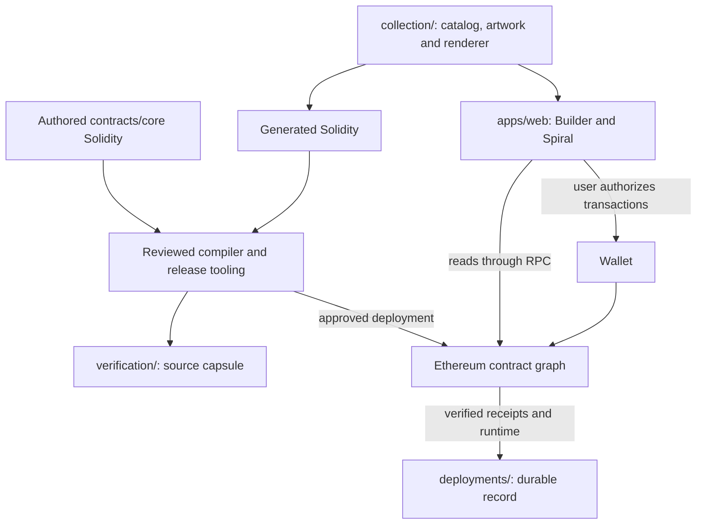

# System architecture

mycelium Friends is one system made from several deliberately separate domains:
the collection source, deterministic build tools, Ethereum contracts, a static
browser application, deployment records and release verification. This page
shows how those parts fit together. Follow the linked domain documents for
implementation details and operating procedures.

## System map

The source capsule can be published before deployment. A deployment record is
created only after the on-chain result has been verified. The browser can also
load a cached or remote snapshot to start faster. A remote snapshot must pass
deployment and RPC checks before use; a previously validated local cache can
start the interface while fresh RPC verification runs in the background. Neither
cache replaces fresh contract reads before a wallet-sensitive action.

The domains meet through reviewed artifacts and explicit interfaces. The web
application does not redefine contract rules, generated Solidity is not edited
by hand, and a deployment record is evidence rather than executable source.

## Responsibility map

| Domain | Owns | Does not own |
| --- | --- | --- |
| [`collection/`](../collection/README.md) | Authored artwork, trait catalog, editorial text and rendering inputs | Contract state or wallet behavior |
| [`contracts/core/`](contracts/core/README.md) | Collection identity, mint protocol, on-chain metadata, original artwork and administrative boundaries | Browser layout or hosting |
| [`apps/web/`](../apps/web/README.md) | Builder, Spiral, wallet experience, responsive UI and browser-safe configuration | Canonical ownership or sale authority |
| [`tooling/`](../tooling/README.md) | Deterministic builds, verification and explicitly gated release commands | Product runtime |
| [`tests/`](../tests/README.md) | Regression, browser, EVM and release-policy checks | Production evidence by themselves |
| [`deployments/`](../deployments/README.md) | Durable verified chain records | Plans, drafts or private journals |
| [`verification/`](../verification/README.md) | Release-scoped source and compiler evidence | Mutable operational state |
| [`infra/`](../infra/render/render.yaml) | Hosting and provider configuration | Application source |

Repository-wide placement, export and release rules live under
[`docs/repository/`](repository/README.md). They govern how the domains are
maintained; they are not another product runtime.

## Authored, generated, deployed and observed

The project distinguishes four kinds of truth:

1. **Authored source** — artwork, catalog, editorial, Solidity, application code
   and build programs reviewed in this repository.
2. **Generated source and assets** — reproducible outputs derived from authored
   inputs. Their generators and equality tests are the authority; generated
   files are never edited independently.
3. **Deployed state** — bytecode, immutable constructor values and transactions
   recorded on Ethereum. A source commit cannot change an existing deployment.
4. **Observed live state** — current ownership, sale phase, supply, royalties and
   other permitted mutable values read from the chain. Historical evidence does
   not replace a fresh chain read.

The [artwork guide](contracts/core/architecture/ARTWORK.md) describes generation
and the artwork lock. The [release runbook](repository/release/RELEASE.md)
describes how reviewed source becomes a deployment candidate and how live state
is checked afterward.

## Collection and mint flow

A visitor chooses six trait indices in the Builder. Together they form a
genotype. Before minting, the browser can render the corresponding canonical
Friend from the same collection inputs used by the contract build.

Public purchases use the contract's buyer-bound commit/reveal protocol. The
contract, not the browser, decides whether a mint is valid, calculates the
price, stores the genotype and assigns the sequential token ID. Original artwork
and metadata are then derived on-chain. The Spiral presents minted tokens in
chronological order; it does not create or reorder ownership history.

See [mint lifecycle and API](contracts/core/architecture/MINTING.md) for the
protocol and recovery behavior, and [web architecture](apps/web/ARCHITECTURE.md)
for wallet, RPC and responsive UI boundaries.

## Trust and control boundaries

The deployed bytecode and immutable constructor values define the permanent
base. Original birth artwork remains independently available. The owner can
exercise only the capabilities implemented by that bytecode, including the
documented sale, royalty, validator and phenotype controls; it cannot silently
replace the contract or rewrite an original genotype.

Primary-mint payments remain in the collection contract until `withdraw()` sends
its ETH balance to the immutable treasury. Browser configuration is public and
contains no signing authority. RPC and snapshot services supply data; they
cannot authorize a mint. Signing, broadcasting and organizational authorization
are separate operator actions with separate review gates. The complete boundary is
documented in [core contract architecture](contracts/core/architecture/ARCHITECTURE.md),
[royalties](contracts/core/architecture/ROYALTIES.md) and
[Safe operations](contracts/core/operations/SAFE-OPERATIONS.md).

## How the architecture grows

Documentation mirrors production ownership instead of flattening all material
by document type. A future application belongs beside `apps/web/` and receives a
matching `docs/apps/<name>/` scope. A future contract domain belongs beside
`contracts/core/` and receives a matching `docs/contracts/<domain>/` scope.
Cross-domain repository rules remain under `docs/repository/`. Follow the
[placement policy](repository/REPOSITORY-STRUCTURE.md) for the exact scope and
approval of any new path.

Here, **core means the current Mycelium Friends contract domain**. The system
map connects that domain to the collection source, application and release
process.
